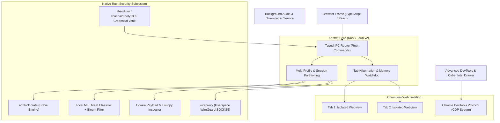

# Kestrel Browser

> **A developer-first, cybersecurity-hardened, AI-augmented browser built in Rust.**

Kestrel is designed from the ground up for web developers, cybersecurity professionals, and privacy-conscious power users. It combines a high-performance Chromium rendering core with a native Rust security layer, custom advanced developer instrumentation, an integrated cybersecurity intelligence radar, and userspace encrypted privacy tunnels.

---

## Architecture Overview

---

## 12 Core Capabilities

1. 🛡️ **Malicious Cookie Engine**: Scans incoming/outgoing cookies for high Shannon entropy, XSS/SQLi payload signatures, and serialization exploits; enforces strict `Secure` and `HttpOnly` flags.
2. ⚡ **Real-Time URL Threat & ML Intercept**: Multi-stage URL interception utilizing an in-memory Bloom filter (PhishTank/URLhaus) and a local quantized ML model (< 25MB ONNX) to halt malicious requests before DNS lookup.
3. 🛠️ **Expert Developer Suite**: Goes far beyond Chromium DevTools with automated framework detection (React, Next.js, Vue, Tailwind, etc.), real-time request/response topology maps, granular waterfall timings, font extractors, and 1-click cURL/Python/fetch code generators.
4. 📡 **Cybersecurity Intel Radar**: Integrated hub for discovering open-source security tools (GitHub repos, live stars), real-time CVE / CISA vulnerability feeds, and site-specific security scorecards.
5. 🚫 **Brave-Grade Ad & Tracker Blocker**: Incorporates Brave's `adblock` Rust engine for sub-millisecond rule evaluation with full EasyList, EasyPrivacy, and cosmetic element-hiding support.
6. 🔐 **Cryptographic Vault & Consent Gatekeeper**: Hardware-backed credential vault (`keyring` + `chacha20poly1305` with Argon2id) requiring explicit user confirmation (PIN/biometrics) before decrypting credentials.
7. 🌐 **Multi-Domain Routing & Parameter Striping**: Automatic sanitization of tracking query parameters (`utm_*`, `fbclid`, `gclid`), referrer hygiene, and domain-partitioned storage.
8. 🔒 **Built-in Userspace VPN**: Integrates `wireproxy` (WireGuard in userspace via gVisor netstack), delivering encrypted system-isolated proxying with zero administrative/UAC elevation.
9. 🧩 **Chrome Extension Compatibility**: Support for Chrome Web Store extensions.
10. 🎵 **Media Hub & Stream Downloader**: Native `yt-dlp` + `ffmpeg` integration for media extraction and a dedicated background audio player that bypasses tab throttling.
11. 🧠 **Intelligent Resource Manager**: Auto-hibernates inactive tabs, freeing RAM and reducing background CPU usage while preserving tab state and scroll position.
12. 🧅 **Tor-Like Circuit Routing**: Multi-hop SOCKS5 relay chaining for privacy without connecting to darknet .onion hidden services, coupled with canvas and audio fingerprint jitter defenses.

---

## Documentation Index

Detailed engineering documentation is located in the [`docs/`](./docs) folder:

- [**Project Vision**](./docs/PROJECT_VISION.md) — Product philosophy, user personas, and design goals.
- [**System Architecture**](./docs/ARCHITECTURE.md) — Process model, `WebContentsView` tab isolation, network interception pipeline, and file hierarchy.
- [**Requirements Specification**](./docs/REQUIREMENTS_SPEC.md) — Comprehensive functional and technical specifications for all 12 modules.
- [**Security & Privacy Deep Dive**](./docs/SECURITY_AND_PRIVACY.md) — Technical mechanics of cookie analysis, URL threat ML, Brave adblock, cryptographic vault, and userspace VPN.
- [**Developer Tools & Intel Radar**](./docs/DEVTOOLS_AND_INTEL.md) — CDP architecture, Wappalyzer rules, live topology graph, developer drawer, and CVE radar.
- [**Implementation Roadmap**](./docs/IMPLEMENTATION_ROADMAP.md) — 6-phase engineering plan from repository scaffolding to production packaging.
