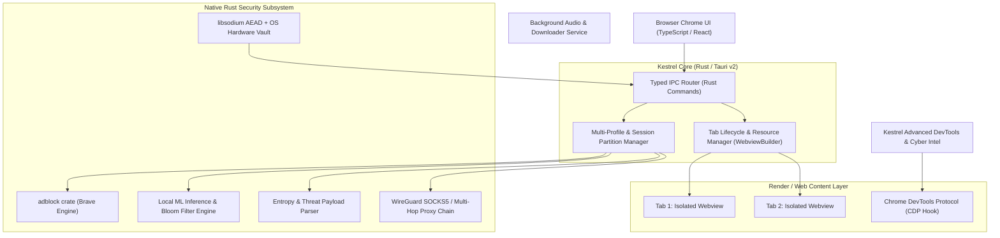

# Kestrel Browser — System Architecture Specification

## 1. Architectural Philosophy: The Native Rust Systems Model

Modern native browsers (Brave, Chrome, Edge) are built using a hybrid systems approach:
- **Systems Core (Rust)**: High-throughput network interception, Brave adblocking engine (`adblock-rs`), local ML inference, cryptographic memory safety, packet routing, and tab lifecycle supervision.
- **Rendering Engine**: OS-native hardware-accelerated Chromium (via Microsoft WebView2 on Windows / WebKit on Linux/macOS).
- **User Interface & DevTools**: GPU-accelerated HTML/CSS/TypeScript rendered by the system compositor and compiled directly into the single Rust `.exe` binary.

Kestrel achieves native C/Rust throughput where it matters while retaining modern UI flexibility and extension compatibility.

